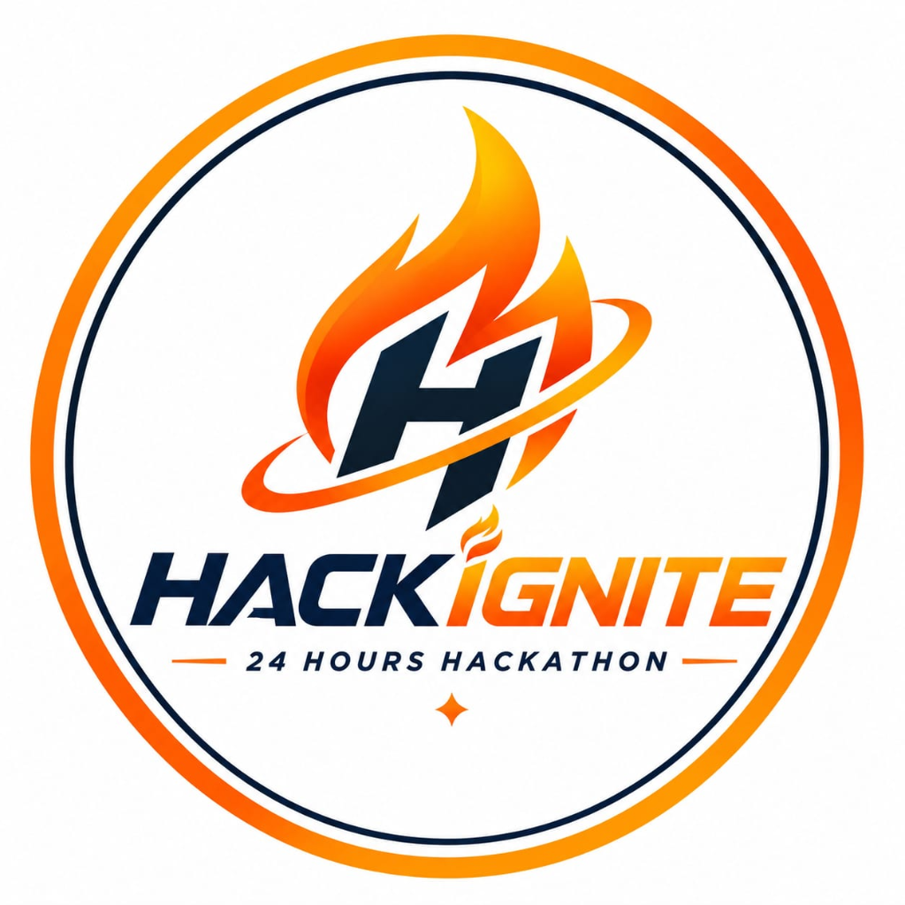

# HACKIGNITE 2026 — National Level 24-Hour Hackathon 🚀🔥

> **Think • Build • Innovate • Impact**  
> Official website for **HACKIGNITE 2026**, a National Level 24-Hour Hackathon hosted by **Jain College of Engineering and Technology (JCET), Hubballi**.



---

## 📌 Event Highlights

| Feature | Details |
|---|---|
| **Event Dates** | 12–13 December 2026 (Kickoff: 11:00 AM IST) |
| **Registration Deadline** | 10 December 2026, 11:00 AM IST |
| **Duration** | 24 Hours Continuous Coding & Innovation |
| **Team Size** | 3 to 4 Members per Squad |
| **Registration Fee** | ₹1,700 per Team (Fixed, Non-refundable) |
| **Venue** | Jain College of Engineering & Technology, Hubballi, Karnataka |
| **Mode** | In-Person National Level Hackathon |

---

## ✨ Features & Visual Architecture

- **Swiss Modernist Design & Editorial Typography**: Space Grotesk display headings, Manrope body text, and clean asymmetric layouts adhering to high-end design principles.
- **Brand Identity & Geometry**: Built around the official HackIgnite emblem featuring vibrant flame arcs, circular rings, and warm ivory/white background (`#FFF9F0` / `#FFFFFF`) with bold navy (`#10243B`) and energetic orange/yellow accents (`#FF6A00` / `#FFB000`).
- **Dynamic Live Countdown**: Dynamic timer targeting 12 Dec 2026, 11:00 AM IST with real-time countdown calculation.
- **4-Step Registration Experience (`<RegistrationModal />`)**:
  - **Step 1 — Team & Lead Profile**: Team name, college, problem track, lead contact details.
  - **Step 2 — Squad Members**: Dynamic roster management for 2 to 3 additional members with validation.
  - **Step 3 — UPI Fee Payment**: Instant dynamic UPI QR code generator (`upi://pay`), UPI ID copy button, transaction/UTR reference field, and terms acknowledgment.
  - **Step 4 — Digital Entry Pass**: Confirmed entry squad pass with unique team ID, confetti celebration, printable/save pass feature (`window.print()`), and local storage persistence.
- **Interactive Multi-Phase Schedule**: Filterable 5-phase 24-hour timeline (Check-in, Hackathon Kickoff, Mentorship, Evaluation, Grand Finale).
- **Comprehensive Rubric & Rules**: 100-point transparent evaluation matrix and 10 strict guidelines.
- **Venue & Travel Guide**: JCET Hubballi campus overview, map links, and multi-modal transit directions (Air, Rail, Bus).
- **Direct Student Coordinators**: One-tap phone call buttons for all official organizers.

---

## 🛠 Tech Stack

- **Framework**: [React 19](https://react.dev/) + [TypeScript](https://www.typescriptlang.org/)
- **Build Tool**: [Vite 8](https://vitejs.dev/)
- **Styling**: [Tailwind CSS v4](https://tailwindcss.com/)
- **Icons**: [Lucide React](https://lucide.dev/)
- **Animations**: [Motion](https://motion.dev/)
- **Celebration Effects**: [Canvas-Confetti](https://github.com/catdad/canvas-confetti)

---

## 📁 Repository Structure

```text
├── index.html                  # HTML entry point with meta tags & Google fonts
├── metadata.json               # Applet identity & permissions
├── package.json                # Dependencies, scripts, and package metadata
├── tsconfig.json               # TypeScript compiler configuration
├── vite.config.ts              # Vite + Tailwind v4 + React configuration
├── .gitignore                  # Git ignore rules for node_modules, dist, etc.
├── .env.example                # Environment variables template
│
├── public/                     # Static assets preserved for production
│   ├── logo.png                # Official HackIgnite high-resolution logo
│   └── assets/
│       ├── logo.png            # Asset copy
│       └── aistudio/
│           └── logo_9820e70d.png # Original logo asset referenced in code
│
└── src/
    ├── main.tsx                # React root mount
    ├── App.tsx                 # Main application page layout
    ├── index.css               # Global Tailwind CSS & typography setup
    ├── data/
    │   └── event.ts            # Tracks, schedule, rubric, rules, and coordinator contacts
    ├── hooks/
    │   └── useCountdown.ts     # Real-time countdown timer hook
    └── components/
        ├── Navbar.tsx          # Sticky navigation with mobile drawer & quick links
        ├── Hero.tsx            # Asymmetric hero with dynamic countdown & logo visual
        ├── Marquee.tsx         # Infinite brand statement ticker
        ├── About.tsx           # Mission, JCET Hubballi background & stats
        ├── Pillars.tsx         # 4 foundational pillars (Think, Build, Innovate, Impact)
        ├── EventDetails.tsx    # Bento grid with fee, tracks, eligibility & perks
        ├── Sponsors.tsx        # Ecosystem and community partners
        ├── Timeline.tsx        # 24-Hour chronological event roadmap
        ├── Awards.tsx          # Podium prizes, tracks, and recognition
        ├── Evaluation.tsx      # 100-Point judging rubric breakdown
        ├── Rules.tsx           # 10 essential hackathon guidelines
        ├── Venue.tsx           # JCET Hubballi location, map & transit instructions
        ├── Coordinators.tsx    # Student organizer directory with direct dial
        ├── FinalCTA.tsx        # Navy high-contrast registration trigger
        ├── Footer.tsx          # Colophon, quick links & copyright
        └── RegistrationModal.tsx # Multi-step registration & printable digital pass
```

---

## 🚀 Getting Started

### 1. Clone the repository
```bash
git clone https://github.com/<your-username>/hackignite-2026.git
cd hackignite-2026
```

### 2. Install dependencies
```bash
npm install
```

### 3. Run development server
```bash
npm run dev
```
Open [http://localhost:3000](http://localhost:3000) to view it in the browser.

### 4. Build for production
```bash
npm run build
```
The optimized production bundle will be generated in the `dist/` directory.

### 5. Preview production build
```bash
npm run preview
```

---

## 📦 Pushing to GitHub

Follow these steps in your terminal to initialize and push this project to a new GitHub repository:

```bash
# 1. Initialize git (if not already done)
git init

# 2. Add all files (code, assets, and configurations)
git add .

# 3. Commit the codebase
git commit -m "Initial commit: HackIgnite 2026 National Hackathon Website"

# 4. Rename main branch
git branch -M main

# 5. Link your GitHub remote repository (replace with your repo URL)
git remote add origin https://github.com/<your-username>/hackignite-2026.git

# 6. Push to GitHub
git push -u origin main
```

---

## 🎓 Organized By
**Jain College of Engineering and Technology (JCET)**  
Hubballi, Karnataka, India  
*Affiliated with Visvesvaraya Technological University (VTU) & Approved by AICTE.*

---
© 2026 HACKIGNITE. All Rights Reserved.
